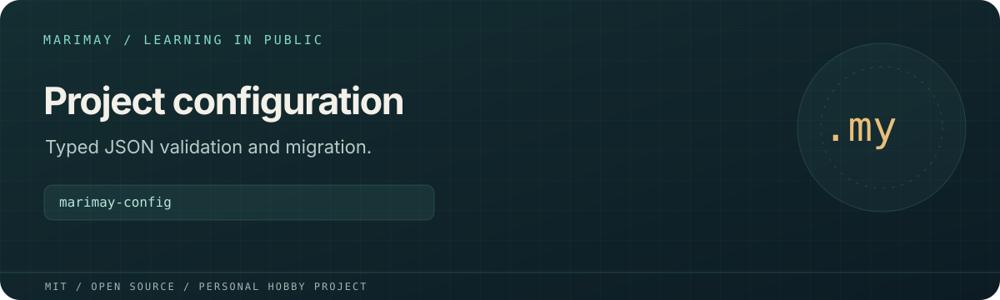

# marimay-config



> **Personal learning project.** This open-source MIT project is part of
> [Marimay](https://github.com/marimay-lang/marimay), my hobby programming-language project.
> I maintain it in my spare time to learn by building. APIs and tooling may
> change, and progress may be intermittent.

Validates and migrates the versioned JSON configuration used by the project scanner examples.

**Status:** Experimental Marimay learning application. Process acceptance scripts exercise
VM and native Debug/Release execution. Full platform and performance acceptance
remain in progress; existing reports retain their recorded revisions and limits.

## Run and verify

```sh
mmay run . -- --help
mmay run . --allow-read fixtures -- validate fixtures/v1.json --json
mmay run . --allow-read fixtures -- migrate fixtures/v1.json
mmay fmt . --check
mmay check .
mmay test . --engine both
MMAY="$(command -v mmay)" python3 tools/acceptance.py
mkdir -p build
mmay build . --release --allow-read fixtures --allow-write build --output build/marimay-config
```

Install a compatible `mmay` and use its matching standard library. Application
arguments follow `--` in `mmay run`. Filesystem and environment access requires
explicit grants; native grants are selected at build time.

Supports scanner configuration versions 1 and 2. Migration preserves values and
adds an empty required-file list. Input can be a path or `-` for stdin.
`--output` and `--in-place` select atomic file replacement and require explicit
write grants. Paths are checked lexically; project files are not inspected.

Python generates synthetic inputs and drives independent process checks;
application logic is written in Marimay. `MMAY=/absolute/path/to/mmay` selects
the compiler for Python drivers. `python3 tools/measure.py` runs the existing
measurement harness and writes local reports under `build/`.

See [`MEASUREMENTS.md`](MEASUREMENTS.md), [`ERGONOMICS.md`](ERGONOMICS.md), [`VERIFICATION.md`](VERIFICATION.md) for project-specific budgets,
findings and historical verification details.

## License

[MIT](LICENSE). Existing copyright attribution is retained.
